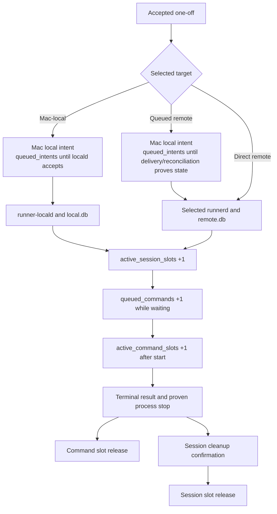

# Operations runbook

Run Mac commands as `tomasz.walczuk` and commands on any accepted Ubuntu
host as `ubuntu`. Do not print private keys, edit SQLite files, manufacture
mailbox input outside the documented publisher/integration path, or use
host-gate test scripts as everyday service controls.

For existing-host Dev/QAS selection and guarded lane-specific updates, see the
[lane operations guide](lanes.md). The procedures there never target unsuffixed
PRD; production changes require a separate approved maintenance package.

## Current availability and evidence boundary

The deployed BUG-015 correction changes how an ordinary strict-shell failure
is classified: a `set -e` or `set -euo pipefail` child failure now returns a
normal terminal `failed` outcome with the real exit code and complete output
boundary. It does not prove a result for an earlier Logger workflow, and it
does not pass a new host gate. See [current-host evidence](current-host-evidence.md#deployed-bug-015-strict-shell-correction).

**Source candidate, pending release acceptance:**
[BUG-026](../050-bugs/026-mac-one-off-run-loses-explicit-preflight-failure.md)
runs a one-off `run` script in a child Bash subshell. An explicit `exit` or
`exec` then returns the child's status through the parent completion protocol;
complete output still requires parent control and output-EOF proof, and
closed teardown requires confirmed normal cleanup. Actual parent-shell death
or uncertain output remains `lost`. Persistent-session `exec` retains its
existing loss semantics. This source change is not evidence of an installed
upgrade: verify the selected lane's accepted release. Never replay or
reclassify a historical lost request because newer code handles that script
differently.

| Capability | Current state | What to verify before use |
| --- | --- | --- |
| Mac local execution | Route is health-addressable when both Mac LaunchAgents are healthy | Both private readiness endpoints, installed revision, and a current authority-capacity check; only then a safe local command. Health alone does not prove retained capacity is free. |
| Direct `linux-host` execution | Accepted on the current host | Public mTLS readiness, then a direct `linux-poc` command. |
| Queued `linux-host` execution | Permanent restricted bridge was accepted in P155 | Fresh bridge `status` at the deployed source revision, then a queued command. |
| Direct `sandbox-host` execution | Accepted in P157 | Public `sandbox-poc` mTLS Runner readiness. |
| Queued `sandbox-host` execution | Accepted in P157 | Fresh sandbox bridge `status`; `analytics` permits its explicit override and `slidestud-io` uses it as its default. |
| Direct `factory-sandbox` execution | Accepted in P157-factory-sandbox | Public `factory-sandbox-poc` mTLS Runner readiness. |
| Queued `factory-sandbox` execution | Accepted in P157-factory-sandbox | Fresh Factory sandbox bridge `status`, then a queued command through `ubuntu-factory-sandbox`. |
| `default` mailbox | Installed and accepted in P155 | Mac readiness, configured root ownership, and native terminal response/event/ACK. |
| `analytics` mailbox | Installed in P155; `sandbox-host` override accepted in P157 | Same checks; each remote override additionally needs its selected bridge status. |
| `slidestud-io` mailbox | Native path accepted in P158; direct workspace-file path accepted in P159 | External owner-only tree, Mac readiness, no-selection request resolved to `sandbox-host`, complete event/ACK, and sandbox P128 zero-work status. |
| `agentic-software-factory-runner-direct` mailbox | Direct-root acceptance recorded in P167; P157 remains the historical legacy-root gate | External owner-only tree, no-selection request resolved to `factory-sandbox`, complete event/ACK, and Factory sandbox zero-work status. |
| Any additional profile | **NOT RUN** | Its own P157 service, route, and end-to-end acceptance. |

P155 proved `default` local-default work and an `analytics` allowed queued
`linux-host` override. P157 independently proved the sandbox bridge, router
health, native mailbox request, event read, ACK, and zero-work state for
`sandbox-host`. P158 then proved the external `slidestud-io` inbox's sandbox
default with the same native request/event/ACK boundary. P159 added the
selected-user-owned exact-`0644` direct workspace-file request and ACK path,
with private `0600` response/event projections and a final zero-work check. A
successful direct mTLS request does not prove queued mailbox delivery. P166
then accepted safe malformed mailbox ingress on the Mac: it wrote a private
diagnostic and created no remote work. It did not run a new host, bridge, or
direct-mTLS gate. P157-factory-sandbox independently accepted the
`factory-sandbox` direct mTLS route, restricted queued bridge, and the
original `agentic-software-factory-runner` native mailbox exchange at
`/Users/tomasz.walczuk/projects/agentic-software-factory/runner/tmp/mailbox-`.
That accepted root is historical evidence. The current direct replacement is
`agentic-software-factory-runner-direct` at
`/Users/tomasz.walczuk/projects/agentic-software-factory/runner/mailbox-`;
its acceptance and controlled legacy-root retirement are tracked in
[`P167`](../040-implementation-evidence/P167-factory-mailbox-retirement.md).
The direct root's omitted selection resolves to `factory-sandbox-dev` /
`remote/factory-sandbox` through `ubuntu-factory-sandbox`; its only mailbox
override is `mac-local`. The direct, queued, and mailbox gates remain distinct.

BUG-008's queue-preserving recovery work and its fresh installed-service
regression (B008-P6) passed. The recovery and attestation procedures below are
operating instructions; following one does not prove a later Runner revision
is installed or that a separate incident is resolved.

### Route-only mailbox check while unrelated receipts remain

The normal P158 gate deliberately requires a fully drained Mac mailbox. Pair
it with a separate sandbox P128 check when zero host work also needs proof. Do
not weaken or reinterpret either gate when historical accepted receipts are
correctly retained inside their bounded uncertainty window. To prove that one
fresh `slidestud-io` request can still use its configured `sandbox-host`
default beside retained `slidestud-io` backlog, run this separate opt-in check
on the Mac:

```sh
# Mac — tomasz.walczuk
cd /Users/tomasz.walczuk/projects/remote-session-runner
make test-p158-slidestud-mailbox-with-backlog
```

It uses the native marker-last client, omits target fields, proves its own
terminal response, complete event stream, ACK, and request-pair consumption.
It records the aggregate and per-inbox backlog before and after the request.
It neither ACKs, cancels, recovers, nor changes unrelated receipts. A pass is
route-only evidence: it does **not** pass P158's zero-backlog gate or P128's
zero-work host gate.

The shared-worker source tests and installer-preflight tests are likewise not
live-host evidence. They do not prove that a particular LaunchAgent or
`runnerd.service` has the reviewed revision, owns the runtime records, or has
completed retained-capacity recovery. Check the running revision and the
selected authority's live status before drawing a conclusion about the Mac or
either Ubuntu host.

## Fresh PRD bootstrap on the replacement Linux worker

This procedure is only for the owner-approved replacement `linux-host` at
`79.72.94.59` (`10.0.0.228`). The retired `129.151.232.40` endpoint is not a
fallback and must remain disabled. The procedure creates a fresh Linux PRD
namespace without importing its database, workspaces, reservations, or
receipts. It preserves the replacement's Dev and QAS namespaces and leaves
the new PRD service unselected and stopped until the normal promotion
transaction.

The fresh-install baseline is part of the synchronized PRD receipt. Older
sealed service runtimes reject that receipt field, so a controller-only update
or the previously accepted `rr-a38cb0057e-877d49e3` is insufficient for this
path. Build a successor with the receipt reader, test it, and accept its
identical per-host bundles in Dev and then QAS before using it here. Do not
rewrite an existing sealed release.

Before bootstrap, confirm that the release has passed Dev and QAS acceptance,
the current release-bound PRD approval is valid, the owner-confirmed publisher
pause remains in force, and fresh read-only plans show the replacement PRD
namespace absent. Keep the owner-only request and approval files outside Git;
the request contains public identity/configuration material and must be mode
`0600`. The command also verifies the pinned SSH host key and checks its
durable coordinator journal. It binds the replacement's fresh-absence proof,
and the Mac route step takes and verifies a consistent Mac PRD backup before
changing that route. The subsequent held `promote-to prd all` preparation
backs up the existing PRD authorities and rechecks the replacement baseline.
Do not manually create namespace files or selectors.

When another worker uses Linux's server-CA file, the Mac route step preserves
the original validated CA bundle and adds the replacement CA once. Unshared
CA files retain replacement-only rotation. The journal binds the installed
bundle digest; retries reconstruct it from the verified original backup,
not from a partially changed live file. A legacy journal that recorded a
destructive shared-file overwrite is rejected without changing its history
or the live repair. Preserve any separately approved trust amendment during
later rollback planning; a historical single-CA backup must not silently
discard the currently approved peer trust.

```sh
# Mac — from the canonical checkout, with the pinned Go 1.27.1 toolchain
runner-release status --release <accepted-successor-release-id> --json
promote-to prd all --release <accepted-successor-release-id> \
  --approval-file <current-owner-approval.json> --plan --json
runner-release prd-replacement-bootstrap \
  --request-file <owner-only-bootstrap-request.json> \
  --approval-file <current-owner-approval.json> \
  --publisher-owner <confirmed-pause-owner> \
  --publisher-control <specific-publisher-pause-control> \
  --publishers-paused --no-new-accepted --json
```

The bootstrap command writes its operation journal before the first remote
CSR/key or namespace mutation and records only input/evidence hashes and stage
identities. On interruption, inspect that journal and the host-local journal;
resume only with the exact same request, release, approval, host profile,
publisher evidence and operation ID. A partial namespace without the matching
journal is a conflict, not an absent installation. Exact retries resume
idempotent directory, configuration, authorized-key, database and baseline
steps; conflicting bytes or intervening changes fail closed. The configured
authorized-key file is backed up in the journal and unrelated key lines are
preserved. The database is created from the current schema in a private staging
file beside its final `state/remote.db` path so the no-overwrite hard link
stays on the same filesystem; its operation marker remains under `staging/`.
It is then installed without overwriting a conflicting path. Creation of the
Linux systemd unit also uses a fixed target and content hash. If interrupted
after the no-overwrite link, an exact retry verifies ownership, mode, and bytes
before removing only the matching staged hardlink. A conflicting unit is left
untouched and stops the operation.

The fresh-install baseline retains the original namespace-absence timestamp
and records the real later preparation time. Its bounded preparation interval
is at most four hours; this accommodates the multi-step first install but does
not extend the release-bound owner approval. The public bootstrap command must
still pass the current approval and publisher checks, and the normal cohort
switch retains its separate fresh per-host preflight requirement.

On this replacement, the existing service root is also the parent of the
verified Go toolchain. The absence report records that exact `toolchain-only`
state. Bootstrap preserves the shared root's existing owner, group and safe
permissions; it does not chmod the toolchain parent to the private mode used
for a new lane directory. Its first locked attempt creates only the canonical
`run/runnerd-lifecycle.lock` entry before the directory step. Retries accept
only that lock, the recorded toolchain, and the exact empty bootstrap
directories; new PRD directories remain owner-only `0700`. Unexpected entries,
changed toolchain bytes, unsafe ownership, or an unrecognized partial
directory tree stop the operation before further writes.

For the one-time bootstrap operation
`02bfdc603d2ea3360ecd32501fe347d1`, a controller-only delivery change may be
resumed only while the coordinator remains at the exact
`server_material_ready` checkpoint. First use the supported
`prd-bootstrap-controller-update` command below with the same request,
approval, host profile, publisher confirmation, pinned SSH identity, and
operation ID. It reconstructs the original host-control digest using the
prior controller revision pinned for this one-time operation, checks that the
digest matches the coordinator journal, and atomically writes a separate
owner-only amendment record. If another controller correction is needed
before the coordinator advances, the supported command appends a new
revision-named record linked to the latest amendment; prior records and the
original journal remain unchanged. The chain permits up to eight controller
revisions for this one operation and refuses an additional amendment before
writing it. Resume validates the complete chain and
unchanged non-controller inputs. Retries with the same inputs return the
existing record; changed request, approval, host profile, SSH identity,
trust, release, predecessor, or certificate bindings are rejected. This is
not a general method to change bootstrap identity or amend an operation after
the coordinator records `linux_namespace_ready`.

A failed host-local step can leave its exact earlier bootstrap effects in
place while the coordinator still records `server_material_ready`. Only the
same operation's journaled retry is allowed to continue that state. For this
operation, the old controller omitted the PRD `SSHAuthorityPath` from the
simple Linux namespace; its failed authorized-key step therefore recorded an
empty-path hash pair but did not append or replace a key. The corrected
`runner-lane` retry recognizes only that incomplete `directories`,
`configuration` prefix and those exact legacy hashes. It verifies the
canonical `/home/ubuntu/.ssh/authorized_keys` path and its owner, parent,
mode, link count, type, and bounded size; then it records the prior hashes and
the actual current file baseline in the owner-only operation journal before
the existing guarded append runs. Existing key lines and file mode are
preserved. Any other step history, changed hash, unsafe path, or concurrent
key-file change stops the retry. This exception does not permit manual edits
to the journal or key file.

```sh
# Mac — from the clean, delivered dev controller checkout
runner-release prd-bootstrap-controller-update \
  --operation 02bfdc603d2ea3360ecd32501fe347d1 \
  --request-file <same-owner-only-bootstrap-request.json> \
  --approval-file <same-current-owner-approval.json> \
  --publisher-owner <same-confirmed-pause-owner> \
  --publisher-control <same-specific-pause-control> \
  --publishers-paused --no-new-accepted --json
```

The amendment is accepted at either the exact `server_material_ready`
checkpoint, before the replacement namespace is created, or at the exact
`linux_namespace_ready` checkpoint when the coordinator contains the Linux
namespace journal hash and no Mac route journal. It is rejected once Mac route
work has started. The latter checkpoint exists so a corrected controller can
resume the same interrupted operation after Linux preparation without
discarding its journal or creating another namespace. The amendment binds the
same request, release, approval, host profile, SSH identity, host-key trust,
predecessor bundles, CSR, certificate and CA material, and the exact
coordinator state. It does not mutate the replacement host. After recording
the amendment, rerun the original `prd-replacement-bootstrap` command with
those exact same inputs; the replacement bootstrap must validate its own
recorded namespace before Mac route work can continue. A lock acquisition
failure is reported as `acquire prd lane lock`; a coordinator identity
mismatch reports the mismatched field names. Do not remove the lane lock or
modify either durable record to work around a failure.

After bootstrap reports `ready_for_catalog_promotion`, collect a new PRD plan.
Bootstrap changes the Mac route/configuration and establishes the replacement
baseline, so do not reuse the pre-bootstrap approval or preflight. Review a
new release-bound approval tied to the fresh configuration, backups, schema,
work inventories and rollback disposition. Then use the normal `promote-to
prd all` prepare/resume path. The replacement host's rollback target is
absence: it must remain stopped, held and unselected. Never restore an older
database automatically, and never let rollback reactivate the retired IP.

Source fixtures exercise interruption and exact retry across every bootstrap
step, conflicting configuration/key/database state, receipt synchronization
with predecessor runtimes that reject the new field, successor receipt
validation, and rollback to the unselected fresh-install baseline. These are
source checks only. Live bootstrap, service acceptance, mailbox acceptance,
and client resumption each require their own recorded result; mailbox
acceptance is `NOT RUN` when no dedicated test exchange is authorized.

## Fast health checks

### Mac — `tomasz.walczuk`

```sh
root='/Users/tomasz.walczuk/Library/Application Support/RemoteSessionRunner'
launchctl print "gui/$(id -u)/com.remote-session-runner.local"
launchctl print "gui/$(id -u)/com.remote-session-runner.locald"
test -S "$root/run/local-api.sock"
test -S "$root/run/locald.sock"
curl --silent --show-error --fail --unix-socket "$root/run/local-api.sock" http://runner/health/ready
curl --silent --show-error --fail --unix-socket "$root/run/locald.sock" http://runner/health/ready
```

### Verify the running Mac build revision

Use the live `runner-local` health response to prove that the process accepting
mailbox work came from the synchronized source revision. Run this after an
installer refresh and before treating a Mac LaunchAgent as current:

```sh
# Mac — tomasz.walczuk
repo='/Users/tomasz.walczuk/projects/remote-session-runner'
root='/Users/tomasz.walczuk/Library/Application Support/RemoteSessionRunner'
expected="$(git -C "$repo" rev-parse HEAD)"
test "$(git -C "$repo" branch --show-current)" = dev
test -z "$(git -C "$repo" status --porcelain)"
test "$expected" = "$(git -C "$repo" rev-parse origin/dev)"
actual="$(
  curl --silent --show-error --fail \
    --unix-socket "$root/run/local-api.sock" \
    http://runner/health/ready |
    /usr/bin/python3 -c 'import json, sys; print(json.load(sys.stdin).get("build_revision", ""))'
)"
test "$actual" = "$expected"
printf 'runner-local live build_revision=%s\n' "$actual"
```

The Mac installer derives the full 40-character Git revision from a clean
`dev` checkout, embeds it in the installed binaries, and requires this live
socket check before it reports success. `build_revision: unattested` means the
binary was not installer-attested and must not be treated as the current
source. `runner-local --version`, a binary checksum, or a newly invoked
`doctor` command identify a file or a new diagnostic process; none identifies
the already-running LaunchAgent. `doctor` also writes a timestamp-only health
record. They are useful diagnostics, but not runtime provenance evidence.

The `runner-local` report contains a `remote_router` check for one queued
profile. With several queued profiles it reports `remote_router/<profile>` per
profile. `ready` means the periodic read-only bridge ping reached that
configured bridge and Runner service. `degraded` means local mailbox ingress
can still be ready, while that queued profile is not currently proven
routable.

Inspect active V2 policy without changing it:

```sh
# Mac — tomasz.walczuk
root='/Users/tomasz.walczuk/Library/Application Support/RemoteSessionRunner'
"$root/bin/runner-local" validate-config --config "$root/config/mac.yaml"
(
  set -e
  check_mailbox_tree() {
    mailbox=$1
    test -d "$mailbox/inbox"
    test -d "$mailbox/outbox"
    test -d "$mailbox/events"
    test -d "$mailbox/acks"
    test -d "$mailbox/diagnostics"
  }
  check_mailbox_tree "$root/mailbox"
  check_mailbox_tree "$root/mailboxes/analytics"
  check_mailbox_tree "/Users/tomasz.walczuk/projects/slidestud.io/tmp/mailbox-"
  check_mailbox_tree "/Users/tomasz.walczuk/projects/agents-work-dispatcher/tmp/mailbox-"
  check_mailbox_tree "/Users/tomasz.walczuk/projects/agentic-software-factory/runner/mailbox-"
)
```

`validate-config` checks file safety and policy only when invoked without
activation flags. It does not make a candidate active. Use the V2 candidate
procedure in [setup](setup.md#3-upgrade-to-version-2-or-add-an-inbox) for a
policy change.

### Inspect mailbox lifecycle without writes

Use the owner-only local API only on the **Mac** as `tomasz.walczuk`. This is a
read-only status query; it does not run `doctor`, import a request, create an
audit row, change an inbox file, or contact a remote host.

```sh
# Mac — tomasz.walczuk
root='/Users/tomasz.walczuk/Library/Application Support/RemoteSessionRunner'
inbox_id='slidestud-io'
request_id='req-EXACT-ID'
curl --silent --show-error \
  --unix-socket "$root/run/local-api.sock" \
  --get --data-urlencode "request_id=$request_id" \
  "http://runner.local/v1/mailboxes/$inbox_id/lifecycle" |
  /usr/bin/python3 -m json.tool
```

The query accepts only an active configured `inbox_id` and an optional safe
`request_id`; it never accepts a mailbox path. `404 mailbox_not_found` means
the configured inbox name is unknown. `503` with `available: false` means the
configured tree or durable lifecycle source could not be read, so no lifecycle
state was inferred. See [mailbox lifecycle status](mailbox.md#read-only-lifecycle-status)
for its metadata-only contract and labels.

Mac logs:

```sh
# Mac — tomasz.walczuk
root='/Users/tomasz.walczuk/Library/Application Support/RemoteSessionRunner'
tail -n 200 "$root/logs/local.stderr.log"
tail -n 200 "$root/logs/locald.stderr.log"
```

For a new safe malformed ingress record, `runner-local` emits one sanitized
line with `mailbox`, `request_id`, `idempotency_key=unavailable`,
`execution_target=not_selected`, `remote_command_id=not_created`,
`lifecycle_phase=ingress_validation`, and a stable `failure_class`. It must
not include a request body, script, token, Authorization header, or private-key
material.

### Inspect a safe invalid-input diagnostic

Use this only with the trusted request ID you published to a configured
mailbox. It reads the private Runner-produced record and does not alter it.

```sh
# Mac — tomasz.walczuk
mailbox='/Users/tomasz.walczuk/projects/slidestud.io/tmp/mailbox-'
request_id='req-EXACT-ID'
/usr/bin/python3 -m json.tool "$mailbox/diagnostics/$request_id.json"
```

The record confirms `accepted: false`, `executed: false`, and the fixed
ingress-validation code. It has no ACK. Correct the source request, then
publish a new JSON/zero-byte-marker pair under a new request ID and idempotency
key. Do not reuse or edit the retained rejected identity.

### `linux-host` Ubuntu — `ubuntu`

```sh
root='/home/ubuntu/.local/share/remote-session-runner'
sudo systemctl is-active runnerd.service
curl --silent --show-error --fail --unix-socket "$root/run/runnerd.sock" http://runner/health/ready
ss -lntH | grep '10.0.0.200:8443'
sudo journalctl -u runnerd.service -n 200 --no-pager
```

Verify the permanent bridge separately:

```sh
# Current Ubuntu — ubuntu
cd /home/ubuntu/projects/remote-session-runner
deploy/ssh/install-queued-bridge.sh status
```

`status` checks account, enabled service, private socket, modes, pinned
identity, exact restricted authorization, controller map, wrapper, and checked
out source revision. It does not alter bridge authorization or durable
configuration. If the source revision advanced, use the normal Linux deployer
in a maintenance window so it refreshes the bridge artifact. Do not treat an
old `ready` result as evidence for a later checkout.

### `sandbox-host` Ubuntu — `ubuntu`

Run these commands through the selected bootstrap alias for the sandbox host:

```sh
# Sandbox Ubuntu — ubuntu
root='/home/ubuntu/.local/share/remote-session-runner'
sudo systemctl is-active runnerd.service
curl --silent --show-error --fail --unix-socket "$root/run/runnerd.sock" http://runner/health/ready
ss -lntH | grep '10.0.0.14:8443'
sudo journalctl -u runnerd.service -n 200 --no-pager
cd /home/ubuntu/projects/remote-session-runner
deploy/ssh/install-queued-bridge.sh status
```

### `factory-sandbox` Ubuntu — `ubuntu`

Run these commands through the selected `factory-sandbox` bootstrap alias on
`oracle-waclaw-dziwulski-ubuntu-micro-01`:

```sh
# Factory sandbox Ubuntu — ubuntu
root='/home/ubuntu/.local/share/remote-session-runner'
sudo systemctl is-active runnerd.service
curl --silent --show-error --fail --unix-socket "$root/run/runnerd.sock" http://runner/health/ready
ss -lntH | grep '10.0.0.30:8443'
sudo journalctl -u runnerd.service -n 200 --no-pager
cd /home/ubuntu/projects/remote-session-runner
deploy/ssh/install-queued-bridge.sh status
```

The service/bridge checks are independent of the public direct mTLS readiness
and the `agentic-software-factory-runner-direct` mailbox terminal exchange.

### Verify a running Ubuntu service build revision

After `install-systemd-service.sh` completes on any accepted host, attest the
live `runnerd.service` process through its private Unix socket. This is the
Linux counterpart of the Mac LaunchAgent check and is required source evidence
for a later B008-P6 host regression; it is not that regression itself.

```sh
# Selected Ubuntu host — ubuntu
repo='/home/ubuntu/projects/remote-session-runner'
root='/home/ubuntu/.local/share/remote-session-runner'
expected="$(git -C "$repo" rev-parse HEAD)"
test "$(git -C "$repo" branch --show-current)" = dev
test -z "$(git -C "$repo" status --porcelain)"
test "$expected" = "$(git -C "$repo" rev-parse origin/dev)"
actual="$(
  curl --silent --show-error --fail \
    --unix-socket "$root/run/runnerd.sock" \
    http://runner/health/ready |
    /usr/bin/python3 -c 'import json, sys; print(json.load(sys.stdin).get("build_revision", ""))'
)"
test "$actual" = "$expected"
printf 'runnerd live build_revision=%s\n' "$actual"
```

As on the Mac, `--version`, a bridge manifest, and a freshly launched `doctor`
command do not attest the running `runnerd.service` process. The installer
requires the exact live `build_revision` after it builds and starts the
service. A matching field proves the service revision, not a mailbox terminal
result or a B008-P6 pass.

### Accepted public direct paths — Mac

```sh
root='/Users/tomasz.walczuk/Library/Application Support/RemoteSessionRunner'
curl --silent --show-error --fail --max-time 15 \
  --cacert "$root/secrets/poc-ca.pem" \
  --cert "$root/secrets/direct-client.pem" \
  --key "$root/secrets/direct-client.key" \
  https://129.151.232.40:8443/health/ready
```

For `sandbox-host`, substitute `sandbox-direct-client.pem`,
`sandbox-direct-client.key`, and `https://132.226.205.205:8443/health/ready`.
For `factory-sandbox`, use `factory-sandbox-ca.pem`,
`factory-sandbox-direct-client.pem`, `factory-sandbox-direct-client.key`, and
`https://145.241.255.66:8443/health/ready`. Each check covers its selected
Runner application, public route, mTLS identity, and readiness. The earlier
temporary TLS probe was transport-only. Neither check confirms a queued bridge
or a mailbox request.

## Diagnostics and metrics

Use a doctor command for configuration, paths, or storage diagnosis:

```sh
# Mac — tomasz.walczuk
root='/Users/tomasz.walczuk/Library/Application Support/RemoteSessionRunner'
"$root/bin/runner-local" doctor --config "$root/config/mac.yaml"
"$root/bin/runner-locald" doctor --config "$root/config/mac.yaml"

# Selected Ubuntu host — ubuntu
root='/home/ubuntu/.local/share/remote-session-runner'
"$root/bin/runnerd" doctor --config "$root/config/linux.yaml"
```

A doctor writes a timestamp-only SQLite health record, so it is diagnostic and
not read-only. It starts the executable named on the command line; it does not
attest the revision of an already-running LaunchAgent or `runnerd.service`.
Use the live private-socket `build_revision` checks above for that purpose.

`/metrics` is available through each private socket and the mTLS HTTPS
listener. It includes bounded counters and no scripts, paths, output,
credentials, or resource IDs.

| Metric | Meaning | Warning threshold |
| --- | --- | ---: |
| `active_session_slots` | Session capacity reservations awaiting cleanup confirmation | 16 |
| `active_command_slots` | Command slots awaiting stop confirmation | 4 |
| `queued_commands` | Authoritative commands still queued | 16 |
| `queued_intents` | Local intents recorded, dispatching, or uncertain | 32 |
| `reconciliation_age_seconds` | Oldest uncertain intent | 300 seconds |
| `event_lag_events` | Remote final sequence minus locally mirrored sequence | 32 |
| `event_gaps_total`, `output_truncations_total` | Durable retained-output problems | 1 |
| `storage_errors_total`, `cleanup_failures_total` | Observed process/database cleanup errors | 1 |
| `mailbox_backlog` | Durable accepted exchanges plus safe complete zero-byte JSON/marker pairs with no durable exchange or diagnostic | 32 |
| `mailbox_backlog_by_inbox` | Same backlog, split by configured safe inbox IDs such as `default`, `analytics`, `slidestud-io`, and `agentic-software-factory-runner-direct` | Inspect each nonzero value |

### How the four queue and slot gauges fit together

These are four durable state gauges, not four separate physical queues. Read
them from the Runner process that returned the health response; do not add a
Mac value to a Linux value.

The three execution gauges belong to one authority at a time: `local.db` for a
Mac-local one-off, or the selected host's `remote.db` for a remote one-off. Do
not add a Mac value to an Ubuntu value. A Mac Router request can also have a
separate delivery-tracking `queued_intents` count before its selected authority
accepts it; this applies to both Mac-local and queued remote requests.



| Gauge | Simple meaning | When it normally drops |
| --- | --- | --- |
| `queued_intents` | A Mac-side record whose delivery outcome is not yet proved. It can represent Mac-local or queued-remote `run`, session creation, command submission, cancellation, or session close. It is not an authority command queue. | A Mac-local authority accepts it, or a remote result is reconciled or conclusively not delivered. |
| `queued_commands` | A command accepted by its execution authority (`runner-locald` or the selected `runnerd`) but waiting for execution. It can wait for a free command slot, a ready session, or an earlier command in the same session. This count does not give a queue position or a general reason for the delay. | The scheduler starts it or it reaches a terminal pre-start outcome. |
| `active_command_slots` | A durable execution reservation for a command that has started on its authority. The current PoC permits four running commands per authority. | Runner has both a terminal command result and proof that the process stopped. |
| `active_session_slots` | A durable session-capacity reservation, normally held from session creation until workspace/runtime cleanup is confirmed on its authority. The current PoC permits 20 active sessions per authority. | The session is closed and cleanup is durably confirmed. |

A ready session with no running command still uses an `active_session_slots`
reservation. Likewise, a terminal `lost` command can continue to occupy an
`active_command_slots` reservation when Runner cannot prove that its process
stopped. That deliberately blocks further starts rather than risk running more
processes than the configured safety limit.

Mac-local and queued-remote requests first have a Mac local-intent delivery
record. Once a Mac-local request is accepted, `runner-locald` and `local.db`
own its `queued_commands` and slot gauges. Once a queued-remote request is
accepted, its selected Linux authority owns those gauges. Direct mTLS remote
requests go straight to the selected Linux authority and create no Mac
`queued_intents` record. The preceding numbers in the metrics table are
operational warning thresholds; the active policy's service limits control
admission and concurrent execution.

A zero backlog does not prove an importer, bridge, or request succeeded. It
only shows no current counted work. Process-local error counters reset after a
daemon restart; retained counters can fall after cleanup.

For a controlled accepted-host restart gate, run this on the selected Ubuntu
host:

```sh
# Selected Ubuntu host — ubuntu
cd /home/ubuntu/projects/remote-session-runner
make test-p128-host-status
```

This evidence test reports active sessions, running commands, unreleased slots,
and unfinished jobs. Use it in a maintenance plan; it is not a general
service-control command.

## Refresh services

### Mac — `tomasz.walczuk`

For an unchanged active policy:

```sh
cd /Users/tomasz.walczuk/projects/remote-session-runner
deploy/macos/install-launchagents.sh
```

The installer requires a clean synchronized `dev` revision and verifies the
live `runner-local` `build_revision` through `local-api.sock`. Preserve that
success output or repeat [the live Mac check](#verify-the-running-mac-build-revision)
before calling the running LaunchAgent current. Do not substitute `--version`
or `doctor` for the socket attestation.

After mailbox ingress is quiesced and before executor bootout, the installer
runs the staged `runner-locald preflight-restart` against the **active**
`mac.yaml` and its active `local.db`, never the candidate configuration. The
installer runs this guard even when launchd does not report a loaded locald,
because a stopped executor can still leave durable work behind. The
read-only gate requires all four durable counts to be zero: active session
slots, active command slots, queued commands, and resumable one-off jobs in
`creating_session`, `accepting_command`, `awaiting_command`, or
`closing_session`. It accepts only the supported pre-upgrade schema-24 or
current authority schema and does not migrate either one.

Any nonzero count, unreadable database, unsupported schema, or uncertain
database path aborts the refresh before `runner-locald` is stopped. The sole
missing-database exception is a true first local-executor install: no loaded
old locald, old locald binary, LaunchAgent plist, locald socket, database, or
SQLite sidecar may exist. The check does not use `doctor`, write health data,
recover capacity, clean up work, or release a slot. It is a restart safety gate,
not an online recovery path.

For mailbox, context, or route policy changes, use an owner-only V2 candidate
and `install-launchagents.sh --config <mac.next.yaml>` as described in
[setup](setup.md#3-upgrade-to-version-2-or-add-an-inbox). Do not modify active
`mac.yaml`, omit a registered inbox through an ordinary candidate activation,
or attempt a V1 rollback after a V2 activation boundary.

`durable_orphan_cleanup` is a separate per-inbox owner decision. Review its
lifecycle status output first. A candidate that enables it is activated through
the same V2 procedure and then requires this Mac service refresh; do not enable
it merely because `mailbox_backlog` is nonzero. The bounded pass removes only
durable-proven marker-only residue and never replays work.

### Retire a superseded external mailbox

First make the replacement root active and prove one fresh native terminal
response, events, and ACK through it. Then use the candidate-revision
read-only `validate-config --check-retained-mailboxes --retire-mailbox ID`
preflight and, only when it is clean, the matching installer
`--retire-mailbox ID` activation described in
[setup](setup.md#retire-a-superseded-external-mailbox). The check is specific
to one registered ID/root pair and refuses active, accepted, or
unacknowledged retained state. Before that installer activation, stop all
processes that can publish to the former root, including native integrations,
direct workspace-file writers, interactive clients, and automation. Runner
service quiescence alone does not stop those writers.

The activation takes the root's exclusive owner-only ingress lock, creates and
syncs a persistent owner-only retirement sentinel, changes `inbox/` and
`acks/` to `0500` with `fchmod`, and rejects any entry in either frozen
directory. It holds the fence while it repeats durable-state validation and
records the retirement. The native client takes the matching shared lock and
checks that sentinel immediately before a request or ACK publication. The
fence is cooperative: raw/direct writers, a same-UID process, or a process
with a retained directory descriptor can evade it, so they must remain
stopped.

One early refusal may safely and atomically unwind to restore the old
services: a **fresh** fence that finds ingress residue before the post-fence
authority open, migration, or retirement tombstone restores the two ingress
directories and removes its sentinel while holding the exclusive lock. Only
after that complete unwind does
the installer restore the prior active configuration and LaunchAgents. Treat it
as a failed retirement: settle the residue and repeat the read-only preflight.

Every other activation failure is no-rollback candidate repair. A preexisting
fence, an incomplete fresh-fence unwind, fence setup failure, or any failure after the
post-fence authority open, migration, or tombstone must not restore the old
configuration, remove the sentinel, restore `inbox/` or `acks/` write
permissions, or restart old publishers. The successful installer records
retirement; it does not remove files from the former root. Verify the new active
`mac.yaml`, both services, and the new root before separately authorized
physical cleanup. Never remove a parent directory, manually alter `local.db`,
or use a service restart to bypass a retirement refusal.

To unload the services explicitly:

```sh
# Mac — tomasz.walczuk
launchctl bootout "gui/$(id -u)" "$HOME/Library/LaunchAgents/com.remote-session-runner.local.plist"
launchctl bootout "gui/$(id -u)" "$HOME/Library/LaunchAgents/com.remote-session-runner.locald.plist"
```

### Selected Ubuntu host — `ubuntu`

First prove its checkout is the pushed Mac commit, then deploy during a quiet
window:

```sh
cd /home/ubuntu/projects/remote-session-runner
deploy/linux/install-systemd-service.sh
sudo systemctl is-active runnerd.service
deploy/ssh/install-queued-bridge.sh status
```

The normal installer repeats the zero-active-work check before restart and
refreshes an already enabled permanent bridge after the new private socket is
ready. It also requires the live `runnerd` `build_revision` to equal the clean
checkout revision. It does not create or rotate dispatcher authorization. Do
not use this installer or a service restart as an attempt to clear retained
capacity while queued work must survive; use the online recovery procedure
below.

## Triage guide

| Symptom | Check | Correct response |
| --- | --- | --- |
| `runner endpoint profile is unavailable or invalid` | Active config, endpoint name, and V2 direct endpoint definition | Review the owner-only config and its secret paths; use candidate activation for changes. |
| `endpoint/target mismatch` | Direct endpoint's bound target profile | Choose the endpoint that is configured for that exact remote profile; do not retry a mutation with a changed target. |
| Partial mailbox selection | Request has only `environment` or `execution_target` | Submit neither to use the inbox default, or submit the complete allowed pair. |
| Mailbox selection or alias rejected | Root, context allow-list, repository alias, response `inbox_id` | Use the intended root and its configured policy; do not invent aliases or host names. |
| Mailbox retirement refused | Complete candidate, exact retired ID/root, lifecycle/retention preflight, publisher quiescence, new-root acceptance, and whether the installer reported a fully restored fresh-residue fence | If it reports the temporary fresh fence was removed and prior services restored, settle the ingress residue and repeat the read-only preflight. Otherwise stay in candidate repair: do not delete files, manually remove a persistent sentinel, restore frozen ingress permissions, or edit SQLite to make the check pass. |
| External mailbox preflight fails | Candidate root's real ancestor chain, owner, modes, and symlink state | Repair the external parent/path without changing its ancestors for Runner; rerun the candidate installer. If activation already began, repair the retained candidate instead of restoring an older policy. |
| No mailbox response | Read-only lifecycle status, then publisher type, root tree, JSON/marker order, owner/mode/path | Follow the deterministic [`request ID → outbox → command ID → events` lookup](mailbox.md#find-a-request-result). For a pair that passed safety but failed ingress validation, inspect `diagnostics/<request_id>.json`: it is private `0600`, has no ACK, and requires a new request ID/key for correction. `request_marker_only`, `ack_marker_only`, or `unsafe_inert` means a marker is not execution evidence; preserve `retain_unproven_inert` entries for review. |
| Lifecycle status is `terminal_unacknowledged` | The matching retained outbox, command ID, event prefix, and response revision | Preserve the terminal evidence, then publish a valid ACK pair. A terminal flag does not mean the command succeeded. |
| Lifecycle status is `terminal_acknowledged` | The durable acknowledgement flag and any retained outbox/event files | The durable record confirms the ACK. Do not recreate an ACK marker just because an old marker is absent. |
| Lifecycle status is `unsafe_inert` or action is `retain_unproven_inert` | The selected root and exact publisher rules | Do not edit, retry, ACK, replay, or enable cleanup from this inference. Correct work through a new complete marker-last pair under a new request ID when appropriate. |
| Direct HTTPS/mTLS failure | Public health, service journal, CA/certificate/principal map/bind | Repair host configuration without printing keys. |
| Queued remote remains recorded, uncertain, or stale | Selected bridge `status`, host-key pin, wrapper, controller map, `runnerd.service` | Preserve the idempotency key and observe the same route; do not resend with a new key. |
| Outbox is `accepted` with `delivery_state=accepted` and a safe nonterminal phase/state, without `queue_blocked_reason` | The same response's stable job/session/command IDs, selected target/profile, and response revision | Runner has a fresh identity-checked read-only authoritative status for accepted nonterminal work. Do not infer a queue blocker, command start, output, or terminal outcome; do not ACK or replay it. Continue observing the same request. |
| Outbox has `queue_blocked_reason=lost_capacity_recovery_pending` | The same response's stable request/job/session/command IDs and response revision | The guarded automatic retained-capacity recovery path is relevant to this queued one-off. It has not completed. Preserve the IDs and observe the same request; do not replay, cancel, restart, or manually alter capacity. |
| Earlier active phase/state disappeared and the outbox is now identity-only `accepted` | Router restart, `is_stale`, authority status/read error, or a strict identity mismatch | Runner withdrew an unsafe-to-repeat active status claim. It did not cancel, release, or replay the authority job. Preserve the request ID and idempotency key; wait for a fresh qualified read or terminal proof. |
| Remote one-off ends `indeterminate` with `delivery_state=accepted` and `remote_status_unavailable` | Stable job/session/command IDs, bridge/service journal, target SQLite status and retention | The target accepted the request but Runner could not prove its terminal result in 24 hours. Do not resubmit or release retained capacity manually. ACK the terminal response if it has been recorded, preserve the IDs and idempotency key, then investigate the target boundary. |
| Mac-local outbox has `queue_blocked_reason=lost_capacity_recovery_pending` | The same request/job/session/command IDs, response revision, and live Mac authority status | Preserve and keep observing the same request. `runner-locald` uses the shared worker, but the Linux recovery commands below do not apply to `local.db`. Do not restart or unload either Mac LaunchAgent, edit SQLite, cancel, replay, or manually release capacity. |
| Linux terminal `lost` capacity blocks ready sessions with queued commands that must survive | The same request/job/session/command IDs, current retained-lost inventory, owner-only markers, and live selected `runnerd.service` | On a `runnerd` revision containing B009-P2, preserve the original IDs and let its bounded dispatcher tick attempt proof-based automatic recovery. It runs only after a normal claim finds all slots full and only for the exact complete retained-lost set; it never replays a lost script. If proof remains unavailable, follow the guarded **Linux-only online** recovery below as the owner-only fallback. Keep the service running; do not restart it, run offline recovery, cancel queued commands, or replay work. |
| Linux P128 reports only one unreleased slot for a terminal lost command and no work must survive | Exact session and command IDs, owner-only runtime record, process-group state, and service cgroup | Preserve the lost result and use the explicit stopped-service recovery procedure below. It refuses any other active work and never replays the script. |
| Linux P128 reports several retained `lost` slots and only already-cancelled one-off jobs, with no queued work to preserve | Exact list of every retained `lost` session/command pair and every nonterminal job, owner-only markers, and the stopped service cgroup | Use `recover-stalled` below only after the complete inventory is known. It rejects extra work and never dispatches or replays a script. |
| New host has no route | Its P157 record and per-host service/materials | Keep it `NOT RUN`; accepted `linux-host`, `sandbox-host`, and `factory-sandbox` evidence does not transfer. |
| Command output incomplete | Cursor, `output_complete`, `output_truncated`, `output_unavailable_reason` | Save the available prefix and do not call it complete. |
| Ordinary script failure under `set -e` or `set -euo pipefail` | Terminal response/event, actual nonzero exit code, complete output flags | Treat this as a normal `failed` command. Preserve the output, correct the script or input, and use a new request only when a new operation is appropriate. |
| `lost` after a strict-shell script | Installed release, one-off `run` versus persistent-session `exec`, explicit `exit`/`exec`, reserved control-file-descriptor changes, and output-boundary evidence | Do not infer a normal command result or complete output. BUG-026's source candidate isolates one-off scripts; it does not change persistent `exec`, prove installed acceptance, or repair old outcomes. Preserve IDs and use the host-specific recovery/investigation boundary. |

## Recovery boundaries

### Mac-local retained capacity: observe, do not remediate live

For a Mac-local one-off, `runner-locald` and `local.db` use the same shared
queue worker as `runnerd`, but runtime proof remains Mac-specific. The public
Linux `recover-retained-capacity`, `recover-lost`, and `recover-stalled`
procedures in this runbook apply only to `runnerd` and `remote.db`; they must
never be pointed at the Mac authority.

When a Mac-local response reports
`queue_blocked_reason=lost_capacity_recovery_pending`, preserve its request,
job, session, and command IDs and keep observing the same response revision
chain. Do not restart or unload the Mac Router or `runner-locald`, edit
`local.db`, cancel the queued work, run a Linux recovery command, manually
release a slot, or publish a replacement request. The field is nonterminal and
does not authorize a live repair. A separate approved Mac maintenance procedure
with fresh host-specific evidence is required before any action that could
change the retained work. In particular, installing or restarting a corrected
Mac executor can release proven capacity and start the original queued identity;
that requires explicit approval after a fresh read-only preflight records the
affected state and expected effect.

### Rebind a Mac Dev/QAS route to the replacement Linux worker

`runner-lane catalog-rebind-linux-peer` is limited to the Mac control plane's
Dev or QAS configuration and the verified replacement address. It accepts a
complete owner-only V3 candidate file plus the matching Linux V3 peer config,
the selected Mac dispatcher public key, and the replacement worker's SSH host
public key. It validates the paired URLs, lane ports, controller and TLS pins,
SSH fingerprints, and that only the
`linux-host` queued address, direct URL, SSH host-key fingerprint, and direct
server-certificate fingerprint changed. Lane policy, controller identity,
mailbox roots, databases, sockets, workspaces, credentials paths, other peer
routes, and PRD remain unchanged.

The command takes the selected catalog and lifecycle locks, stops only that
lane after proving its work inventory empty, creates a verified consistent
configuration/database backup, rechecks selector/configuration/schema/work
identities, preserves the original `known_hosts` file in that backup, and
records a private rebind journal. It adds the new verified SSH host key before
atomically replacing the config. The selected service stays stopped throughout
the transition. Once the new route is active in the config, reduce the active
`known_hosts` file to its one exact replacement-host pin with the guarded
`catalog-refresh-linux-known-hosts` command below. The complete prior file,
including the retired pin, remains in the consistent backup. This final step
is required because the runtime SSH client accepts only an unambiguous pinned
host-key file. Do not use these commands for PRD, another peer, or a general
configuration edit. The new host key and TLS certificate still need to pass
strict SSH and TLS validation during live acceptance.

```sh
# Mac — tomasz.walczuk — use the exact current config hash and prepared owner-only candidate
GO="/Users/tomasz.walczuk/Library/Application Support/RemoteSessionRunner/toolchains/go1.27.1/bin/go"
GOCACHE=/private/tmp/remote-session-runner-gocache \
GOMODCACHE=/private/tmp/remote-session-runner-gomodcache GOTOOLCHAIN=local \
  "$GO" run ./src/cmd/runner-lane catalog-rebind-linux-peer \
    --host mac-control-plane --lane dev \
    --config-file /private/tmp/runner-lane-mac-dev-candidate.yaml \
    --peer-config-file /private/tmp/runner-lane-linux-dev.yaml \
    --dispatcher-public-key-file /private/tmp/runner-lane-dispatcher-dev.pub \
    --host-public-key-file /private/tmp/runner-lane-linux-host-ed25519.pub \
    --expected-config-sha256 '<current-dev-config-sha256>'
```

After the route rebind, inspect only the two digests, then run the selected-lane
refresh while the service remains stopped. The command checks the exact V3
route and fingerprint, takes a consistent configuration/database backup,
preserves the complete prior `known_hosts` bytes beside that backup, and
atomically installs only the verified replacement-host entry. The private
completion receipt binds both hashes to the backup manifest. It does not
change configuration, database, lane identity credentials, selector, or
service binaries. After interruption, re-read both hashes and rerun with those
fresh values; the exact replacement-only state is accepted idempotently.

```sh
# Mac — tomasz.walczuk — complete the selected Dev route transition
LANE_ROOT="$HOME/Library/Application Support/RemoteSessionRunner-dev"
CONFIG="$LANE_ROOT/config/mac.yaml"
KNOWN="$LANE_ROOT/secrets/profiles/linux-host/ssh/known_hosts"
CONFIG_SHA=$(/usr/bin/shasum -a 256 "$CONFIG" | /usr/bin/awk '{print $1}')
KNOWN_SHA=$(/usr/bin/shasum -a 256 "$KNOWN" | /usr/bin/awk '{print $1}')
GO="/Users/tomasz.walczuk/Library/Application Support/RemoteSessionRunner/toolchains/go1.27.1/bin/go"
GOCACHE=/private/tmp/remote-session-runner-gocache \
GOMODCACHE=/private/tmp/remote-session-runner-gomodcache GOTOOLCHAIN=local \
  "$GO" run ./src/cmd/runner-lane catalog-refresh-linux-known-hosts \
    --host mac-control-plane --lane dev \
    --expected-config-sha256 "$CONFIG_SHA" \
    --expected-known-hosts-sha256 "$KNOWN_SHA"
```

The peer configuration and public keys are read-only identity inputs. The
dispatcher public key must match the existing lane private key; the worker
host key must match both the peer config and the candidate Mac config. Run QAS
only after Dev acceptance, with `--lane qas`, its own candidate/peer pair,
keys, and freshly measured configuration hash. Preserve the JSON backup and
rebind evidence, then verify the service remains stopped before beginning the
selected-lane promotion.

### Read-only retained-work inventory before Mac recovery

Use the supported detailed inventory command on the **Mac**, as the account
that owns the selected lane:

```sh
# Mac — qualified runner-lane diagnostic executable, selected PRD authority
runner-lane catalog-work-inventory --host mac-control-plane --lane prd --details
```

Choose `--lane dev` or `--lane qas` to inspect that lane instead. The command
does not require an idle database or a service stop. It reads the selected
authority across all mailboxes in one SQLite read transaction, including
retained pairs, commandless and completed-command holds, unreleased session
reservations and command slots, active/queued work, resumable jobs, and pending
recovery finalizations. Local and remote delivery intents are reported
separately from execution state. Scripts, command output, credential material,
and environment values are excluded.

Use output only when the command exits zero and `inventory_complete` is true.
The report binds the read cut to the exact host/lane, private database identity,
configuration digest, selected service artifact and schema, diagnostic-tool
revision, and observation interval. The selected artifact revision identifies
the catalog selection; it is not an independent attestation of a running PID.
Configuration, selector or database replacement during the read, an unsupported
schema, missing required tables, a query failure, or the row/output limit makes
the export fail rather than claim an empty or complete inventory. There is no
pagination that could silently omit work.

The detailed command requires an existing private WAL/SHM pair. If those
read-coordination files are unavailable it refuses before opening SQLite,
rather than create them. Ordinary SQLite reader coordination may update SHM
lock bookkeeping; application data, WAL contents, schema and runtime artifacts
are not changed by the diagnostic.

The initial detailed-export compatibility contract is **schema 40** with its
verified migration history and required table shapes. Use a qualified native
`runner-lane` containing BUG-027; the older installed command's aggregate
counts are not a substitute. A diagnostic-only executable may be installed in
an owner-private directory outside the release catalog after fixture and native
qualification. Record its full source revision, binary SHA-256 and supported
schema alongside the report. This does not replace service binaries or promote
a release. See [BUG-027 verification](../040-implementation-evidence/BUG-027.md)
for the qualified artifact and live read-only result.

Even a complete report returns `safe_to_resume=not_established` and
`recovery_authorized=false`. It is an inventory for planning; it does not prove
runtime cleanup, release capacity, ACK responses, replay work, authorize
recovery, or clear clients to resume. Preserve the report privately and pass
the exact identities to the separately approved recovery procedure, which
revalidates its own fresh process, ownership and work guards.

### Explicit Mac offline recovery for a fully idle retained-lost set

Use this procedure only when a fresh inventory proves that **no work must
survive** and every retained Mac capacity record belongs to a known terminal
`lost` runtime. Use a pair only for a real terminal lost command; use a session
only for a terminal lost one-off job with no persisted command row. It is a
narrow offline maintenance route for a fully idle Mac authority. It is not a
mailbox operation, public API, normal Runner CLI command, or a way to clear a
queued request.

Before starting, preserve the complete inventory. Supply every retained
terminal-lost session/command pair as an exact `--lost-pair` argument. Supply
`--lost-session` only for a terminal lost one-off session that never received a
persisted command row. The recovery refuses an extra, omitted, duplicate,
nonterminal, or mismatched input; any running command, active unknown
reservation, queued command, resumable one-off job, unreadable database, or
uncertain runtime ownership also refuses the operation. Do not use it while any
request or command needs to survive.

Run only the installer-mediated command from the authoritative Mac checkout:

```sh
# Mac — tomasz.walczuk
cd /Users/tomasz.walczuk/projects/remote-session-runner
deploy/macos/install-launchagents.sh --recover-stalled \
  --lost-pair 'sess-EXACT-LOST-1:cmd-EXACT-LOST-1' \
  --lost-pair 'sess-EXACT-LOST-2:cmd-EXACT-LOST-2' \
  --lost-session 'sess-EXACT-COMMANDLESS-LOST-3'
```

Do **not** run `launchctl` manually, call `runner-locald recover-stalled` with
`go run` or an installed binary, edit or copy `local.db`, release a slot, or
signal a recorded child process yourself. Those actions bypass the lifecycle
and ownership checks.

The installer stages the candidate binaries, captures the old Router and locald
process identities, stops ingress and then locald, and proves that both old
processes have exited or are inert. It installs the stopped candidate binaries
before it invokes shared recovery, so a schema migration cannot be followed by
a restart of an older executable. The recovery holds an exclusive lifecycle
lock, checks the complete durable inventory, proves the selected runtime cleanup
boundary, and releases only the supplied pairs/sessions. It never reads, starts,
or replays a stored script.

If paired capacity was already released but the durable marker/workspace
finalization remains pending, retry the **same** installer command only when
every pending pair/session is again supplied explicitly and the fresh idle inventory
still passes. The retry finalizes only that retained cleanup; it does not signal
the runtime again or replay work. A missing, extra, or unrelated pending input
is a refusal. The current BUG-014 inventory has no pending finalization.

On success, its postflight requires zero active session slots, zero active
command slots, zero running commands, zero live reservations, and zero
nonterminal jobs before the installer performs the ordinary candidate restart.
Before it enters the stopped-candidate handoff, a refusal may restore the
active services. After that boundary, a refusal deliberately leaves both
LaunchAgents stopped. Correct the complete evidence set, confirm both labels
and both private sockets are absent, then rerun the **same** installer command;
do not start an older binary, invent a command, or manually change SQLite.
After restart, prove the installed revision and all-zero Mac authority status,
then use one fresh harmless mailbox request for live acceptance. Preserve the
old lost records and do not reuse their request or idempotency identities.

### Explicit Mac recovery for a completed command with lost teardown

A one-off command can already have its truthful terminal result while its
session teardown is `lost` and still holds session capacity. The supported
selection covers either a successful exit 0 with `command_succeeded`, or an
ordinary failed command with a nonzero exit and matching `command_failed`
terminal event. Both require complete, non-truncated, available output and the
already released command slot. Cancelled, timed-out, rejected, lost, shell-exit,
transport-uncertain, missing-exit, and inconsistent command/job/event records
remain ineligible. This is not lost-command recovery. After an approved fresh
idle inventory and exact ownership proof, use the separate completed-command
selection through the same stopped-candidate installer boundary:

```sh
# Mac — tomasz.walczuk
cd /Users/tomasz.walczuk/projects/remote-session-runner
deploy/macos/install-launchagents.sh --recover-stalled \
  --teardown-pair 'sess-EXACT-TEARDOWN:cmd-EXACT-COMPLETED'
```

Supply the complete exact retained teardown set, repeating `--teardown-pair`
when necessary. Do not combine it with `--lost-pair`, `--lost-session`, a
failed-startup recovery, or `--config`. The latter is a separate candidate
activation after recovery and its zero-work postflight succeed. The guard
refuses active/running/queued/nonterminal work, any live command capacity,
unselected retained session capacity, unrelated pending cleanup, or uncertain
runtime ownership. For a failed command, it additionally requires
`command.state=failed`, a nonzero exit code, matching job state and exit code,
complete output metadata, and the exact `command_failed` event at the final
sequence. A fully released historical pair is refused unless its
completed-teardown finalization remains durably pending and explicitly selected.

Recovery preserves the original succeeded or failed result, exit code, output,
and event prefix; it never replays a script, changes a failure to success, or
relabels a failed command as lost. It proves runtime cleanup before releasing the selected
session reservation. If finalization remains pending after release, retry only
the same complete explicit set; do not repeat runtime signalling or manually
remove ownership evidence. Postflight requires every recovery finalization
table and the complete active/queued/capacity inventory to be empty before the
installer restarts the candidate services. Held original ACKs retain their
separate evidence-based disposition; this command does not authorize speculative
ACKs or deletion.

### Linux-only queue-preserving online retained-capacity recovery

This procedure is only for the selected Ubuntu `runnerd` authority and its
`remote.db`; it is not a Mac `runner-locald` procedure. On a `runnerd` revision
containing B009-P2, the normal first action is to preserve the original request,
job, session, and command IDs and let the bounded dispatcher tick try
proof-based recovery. It does this only after its normal scheduler claim sees
full command capacity and only for the complete, exact retained-lost inventory.
A successful proof releases paired capacity and wakes the existing dispatcher
to claim the original queued command. It never replays a terminal-lost script
or creates replacement work.

The same accepted mailbox response can expose
`queue_blocked_reason=lost_capacity_recovery_pending` while that exact
condition is freshly proven for either supported execution target. It is an
observation only. On Linux, B009-P2 performs the guarded recovery; on the Mac,
the observation does not make this Linux-only procedure applicable. The field
does not authorize a manual action and can disappear before a terminal result.

Use this owner-only local Ubuntu maintenance procedure only as a guarded
fallback when terminal `lost` capacity still blocks one or more
identity-checked ready sessions with queued commands that must remain queued.
Public HTTPS, the SSH bridge, the mailbox, and normal requester CLI routes
cannot invoke it. Before invoking it, record a complete
inventory of every retained `lost` session/command pair and every preserved
ready/queued session, command, and job. The selected lost pairs must account
for every live command slot; the service must be active; and there must be no
running or cancelling command. The command rejects a partial, extra,
nonterminal, or mismatched inventory.

While work is being preserved, do **not** stop or restart `runnerd.service`,
run `deploy/linux/install-systemd-service.sh`, use the offline `recover-lost`
or `recover-stalled` commands, cancel or close the queued session/command, edit
SQLite, release a slot manually, or publish a replacement/replay request. Each
of those actions changes or discards the work the online procedure is designed
to preserve.

```sh
# Selected Ubuntu host — ubuntu
(
  set -eu
  root='/home/ubuntu/.local/share/remote-session-runner'

  # This must remain active for the whole operation.
  sudo systemctl is-active --quiet runnerd.service

  "$root/bin/runnerd" recover-retained-capacity \
    --config "$root/config/linux.yaml" \
    --online \
    --apply \
    --lost-pair 'sess-EXACT-LOST-1:cmd-EXACT-LOST-1' \
    --lost-pair 'sess-EXACT-LOST-2:cmd-EXACT-LOST-2'
)
```

The explicit `--online --apply` flags and every `--lost-pair` are required. The
operation holds the exact selected capacity until each runtime cleanup proof is
complete, then releases the selected pairs in one authority transaction. It
does not execute a stored script. Only after that transaction can the normal
running dispatcher claim the **original** queued command ID in normal order.
If cleanup proof or inventory validation fails, capacity and preserved work
remain unchanged; stop and investigate the reported sanitized reason. Do not
try a different recovery mode to force progress.

After a successful release, observe the original request through its existing
outbox, event file, and terminal ACK sequence. A service revision match or a
successful capacity release is not command completion. B008-P6 is historical
evidence for BUG-008; it does not prove a later B009 revision is installed or
that this request reached a terminal outcome.

### Offline recovery only when no queued work must survive

The legacy stopped-service procedures below are intentionally stricter. They
are valid only when the complete inventory proves there is no queued work to
preserve, or when the work has already reached a separately authorized terminal
disposition. They are Linux `runnerd` procedures. The separate Mac procedure
above remains installer-mediated and is not a public retained-capacity command.
Never use either stopped-service procedure as a substitute for the online
procedure above.

- Do not manually edit `local.db` or `remote.db`, or copy a live SQLite file.
- For a planned Mac disk wipe, use the supported offline continuity kit at
  [`deploy/backup`](../deploy/backup/README.md). It verifies a quiescent Mac
  boundary, stops Router before `runner-locald`, copies state and all configured
  mailbox roots, and leaves services stopped. It is not a live backup scheduler
  or a substitute for remote-host recovery.
- A restore does not reattach previous runtime processes. Lost work and
  reconciliation must finish before new dispatch.
- Graceful shutdown stops admission, drains for a bounded period, then uses
  normal cancellation/close cleanup. Clients resume retained events after
  their last validated sequence.
- After a Mac Router restart, a Mac-local one-off reads the shared Mac
  authority in `local.db` (its executor is `runner-locald`), and a queued
  remote one-off reads the selected remote authority state. Neither path resends
  the accepted mutation.
- A remote run that remains unreadable after target acceptance ends as a
  terminal `remote_status_unavailable` mailbox response after 24 hours. It
  carries stable IDs but no claimed target outcome; preserve its idempotency key
  and investigate rather than replaying its script.
- A private ingress diagnostic has no ACK and is eligible for cleanup seven
  days after observation. Its durable rejection-ledger identity remains through
  normal 90-day metadata retention; do not try to revive it by editing its old
  request files.
- A terminal `lost` command can retain capacity until the runtime process group
  is proven gone. Do not release that capacity with SQLite edits or a generic
  service restart. When P128 reports exactly one retained slot and no other
  active sessions, running commands, or unfinished jobs, use the guarded
  installer recovery with the exact session and command IDs obtained during the
  investigation:

  ```sh
  # Selected Ubuntu host — ubuntu
  cd /home/ubuntu/projects/remote-session-runner
  deploy/linux/install-systemd-service.sh --recover-stalled \
    --lost-pair 'sess-EXACT-ID:cmd-EXACT-ID'
  ```

  The installer stages a schema-compatible candidate before it stops the
  service. It then proves the stopped cgroup and private-socket boundary,
  validates the complete durable inventory, and runs the existing lost-runtime
  recovery. It requires the P128 zero-work result before starting the candidate.
  It validates the matching `lost` session/command and never executes or replays
  the stored script. If finalization fails after the paired release, it leaves
  the service stopped; rerun the identical installer command only after fresh
  evidence confirms the same complete inventory. It finalizes only the retained
  marker/workspace and does not signal a PID again. An unconfirmed pre-release
  cleanup is a failure; leave capacity retained and investigate the ownership
  boundary.
- When P128 reports a complete set of several terminal `lost` records plus
  stranded one-off jobs whose commands are already `cancelled`, use the batch
  repair only with **every** affected ID. It is for recovery records, not for
  a normal queued request or a way to bypass a host gate. The command rejects
  any active session or running command, any extra pending job, any extra
  retained slot/reservation, or an unknown ownership marker. It requires each
  listed job to prove the narrow pre-execution history
  `command_queued → command_cancelled`, with a closed session and released
  reservation. It never reads a request body for execution, starts a
  dispatcher, or sources a script.

  ```sh
  # Selected Ubuntu host — ubuntu
  cd /home/ubuntu/projects/remote-session-runner
  deploy/linux/install-systemd-service.sh --recover-stalled \
    --job-id 'job-EXACT-CANCELLED-JOB-1' \
    --job-id 'job-EXACT-CANCELLED-JOB-2' \
    --lost-pair 'sess-EXACT-LOST-1:cmd-EXACT-LOST-1' \
    --lost-pair 'sess-EXACT-LOST-2:cmd-EXACT-LOST-2' \
    --lost-session 'sess-EXACT-COMMANDLESS-3'
  ```

  The installer stages the candidate before stopping the current service, so a
  schema migration followed by a refusal never leaves an older incompatible
  binary selected. Its `recover-stalled` step settles the proven cancelled jobs
  in one SQLite transaction, proves every listed lost process boundary while
  capacity remains held, releases all listed slot/reservation pairs in one
  transaction, and only then removes proven owner markers and workspaces. If
  any proof or database write fails, it leaves the service stopped with the
  candidate in place and lost capacity retained. If a final marker cleanup fails
  after release, rerun the identical installer command only after fresh evidence
  confirms the complete inventory; the retry finalizes only the retained marker
  and does not signal a PID or replay work. The installer itself requires the
  P128 zero-work result before it starts the candidate.
- Software-crash recovery is evidenced. Physical power-loss survival remains
  unverified until a coordinated physical power-cut test passes.

See [current-host evidence](current-host-evidence.md) for exact P155, P157,
P157-factory-sandbox, P158/P159/P166 scope and [setup](setup.md) for deployment
steps.
